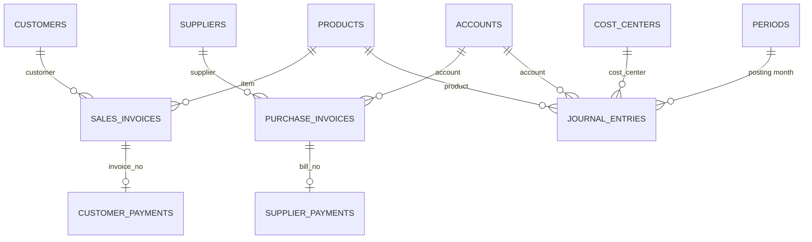

# Data schema / 数据结构

Every file the project produces, what each column means, and how the files link.
项目生成的所有文件、每一列的含义,以及文件之间如何关联。

Rows as of generator piece 4 (simulation year 2024). Regenerate with:

```
python data/design_inputs.py ../pharma-market-analytics   # step 1: product plan
python data/generate_transactions.py                       # step 2: transactions
```

## 1. How the data flows / 数据流

```
pharma-market-analytics (real CMS 2024 data)
        │ design_inputs.py
        ▼
design_inputs.csv  (3 products: price, volume, GTN rates, unit cost)
        │ generate_transactions.py  (fixed seed 2024)
        ▼
sales_invoices ─► customer_payments
purchase_invoices ─► supplier_payments
journal_entries            periods            expected_trial_balance
bank_transactions (bank statement)
        │ you: import into ERPNext → ERPNext writes the general ledger
        ▼
your SQL database (stage 4) → controls (stage 5) → reporting (stage 6)
```

## 2. How the tables link / 表之间的关系



- Each sales invoice has **zero or one** payment (zero = still open in AR at 31 Dec).
- Each purchase invoice has **zero or one** payment (zero = still open in AP at 31 Dec).
- Payments link to their document by `invoice_no` / `bill_no`. This link is what control 7 (unapplied payments) and control 2 (subledger = GL) rely on.
- 每张销售发票有 0 或 1 笔收款(0 = 年末仍未收);每张采购发票有 0 或 1 笔付款(0 = 年末仍未付)。付款通过 `invoice_no` / `bill_no` 关联到单据,控制 7 和控制 2 依靠这个关联。

## 3. Transaction tables / 交易表

Keys: **PK** = primary key (unique per row), **FK** = links to another table.

### sales_invoices.csv: 1,047 rows, one per wholesaler order / 销售发票

| Column | Type | Key | Meaning | Example |
|---|---|---|---|---|
| invoice_no | text | PK | Invoice number | SINV-2024-00001 |
| posting_date | date | | Date the sale is recorded | 2024-01-02 |
| customer | text | FK → customers | Wholesaler | Keystone Pharma Wholesale |
| item | text | FK → products | Product sold | Onkalyn |
| qty | integer | | Units (claims-equivalent) | 1 |
| rate | number | | Gross price per unit, USD | 13301 |
| amount | number | | qty × rate, USD (gross, before GTN) | 13301 |
| cost_center | text | FK → cost_centers | Always Commercial | Commercial |
| due_date | date | | posting_date + 30 days (Net 30) | 2024-02-01 |

**Ledger effect:** Dr 1100 Accounts receivable / Cr 4000 Gross product sales.

### customer_payments.csv: 959 rows / 客户收款

| Column | Type | Key | Meaning | Example |
|---|---|---|---|---|
| payment_no | text | PK | Payment number | PAY-IN-2024-00001 |
| payment_date | date | | Date cash arrives | 2024-01-30 |
| customer | text | FK → customers | Who paid | Northstar Drug Supply |
| invoice_no | text | FK → sales_invoices | Invoice paid | SINV-2024-00003 |
| invoice_amount | number | | Full invoice amount | 26602 |
| discount | number | | 2% prompt-pay discount if on time, else 0 | 532 |
| amount_received | number | | invoice_amount − discount | 26070 |
| on_time | true/false | | Paid by the due date | True |

**Ledger effect:** Dr 1000 Bank (amount_received) + Dr 4400 Prompt-pay discounts (discount) / Cr 1100 Accounts receivable (invoice_amount).

### purchase_invoices.csv: 192 rows / 采购发票

| Column | Type | Key | Meaning | Example |
|---|---|---|---|---|
| bill_no | text | PK | Supplier bill number | PINV-2024-00001 |
| posting_date | date | | Date the bill is recorded | 2024-01-02 |
| supplier | text | FK → suppliers | Supplier | Arclight Clinical Research |
| account | text | FK → accounts | What it's charged to | 6100 R&D |
| cost_center | text | FK → cost_centers | Department | R&D |
| amount | number | | USD | 56004.61 |
| due_date | date | | posting_date + 45 days (Net 45) | 2024-02-16 |

**Ledger effect:** Dr account (inventory or department expense) / Cr 2000 Accounts payable.

### supplier_payments.csv: 173 rows / 供应商付款

| Column | Type | Key | Meaning | Example |
|---|---|---|---|---|
| payment_no | text | PK | Payment number | PAY-OUT-2024-00001 |
| payment_date | date | | Weekly Thursday payment run (Friday if Thursday is a holiday) | 2024-02-15 |
| supplier | text | FK → suppliers | Who was paid | Arclight Clinical Research |
| bill_no | text | FK → purchase_invoices | Bill paid | PINV-2024-00001 |
| amount_paid | number | | USD, full bill amount | 56004.61 |
| on_time | true/false | | Paid by the due date | True |

**Ledger effect:** Dr 2000 Accounts payable / Cr 1000 Bank.

### journal_entries.csv: 90 entries, 330 lines / 日记账

One row per **line**; all lines with the same `je_no` form one balanced entry (debits = credits).
每行是一条分录**行**,同一个 `je_no` 的所有行构成一笔借贷平衡的分录。

| Column | Type | Key | Meaning | Example |
|---|---|---|---|---|
| je_no | text | PK with line order | Entry number | JE-2024-00004 |
| posting_date | date | | Date posted | 2024-01-31 |
| je_type | text | | Opening balance, Payroll, Bank fee, COGS, Rebate / Chargeback / Returns accrual or settlement | Rebate accrual |
| account | text | FK → accounts | Account | 4100 Rebates |
| debit | number | | USD | 295160.4 |
| credit | number | | USD | 0.0 |
| cost_center | text | FK → cost_centers | Department, blank for balance sheet lines | Commercial |
| product | text | FK → products | Product, on COGS and accrual lines | Glyvanta |
| party | text | | Who is paid, on settlements | Payer rebate programs |
| remark | text | | Description | Rebate accrual Jan 2024 |

| je_type | Entries | Entry |
|---|---|---|
| Opening balance | 1 | Dr Bank, Inventory / Cr Equity |
| Payroll | 12 | Dr 6000–6300 by cost center / Cr Bank |
| Bank fee | 12 | Dr 6300 G&A 250 / Cr Bank (monthly service charge) |
| COGS | 12 | Dr 5000 COGS (by product) / Cr 1200 Inventory |
| Rebate accrual | 12 | Dr 4100 (by product) / Cr 2100 |
| Chargeback accrual | 12 | Dr 4200 (by product) / Cr 2110 |
| Returns accrual | 12 | Dr 4300 (by product) / Cr 2120 |
| Rebate settlement | 3 | Dr 2100 / Cr Bank, ± true-up to 4100 |
| Chargeback settlement | 11 | Dr 2110 / Cr Bank, ± true-up to 4200 |
| Returns settlement | 3 | Dr 2120 / Cr Bank, ± true-up to 4300 |

### bank_transactions.csv: 1,170 rows, the bank statement / 银行流水

One line for every cash movement the bank processed by 31 Dec: customer receipts, supplier payments, payroll, GTN settlements and the bank's service charge. The statement opening balance is $5,000,000.
银行在 12 月 31 日前处理的每一笔现金流动一行。期初余额 $5,000,000。

| Column | Type | Key | Meaning | Example |
|---|---|---|---|---|
| bank_txn_id | text | PK | Bank line number | BANK-2024-00004 |
| bank_date | date | | Date the bank processed it: receipts 0–1, supplier ACH 1–2, settlements 1–2 business days after the book date; payroll and fees same day | 2024-02-01 |
| amount | number | | USD; + money in, − money out | 20703.0 |
| reference | text | | What the payer wrote: an invoice number on 90% of receipts, Halvern's payment or JE number on outgoing payments, blank otherwise | SINV-2024-00004 |
| description | text | | Bank's text | ACH CREDIT KEYSTONE PHARMA WHOLESALE |

There is **no column linking a bank line to a book entry**: finding the match (amount, date within ±3 days, reference when present) is control 3's job. 74 receipts have no reference and must be matched on amount and date alone.
**没有**直接关联账面记录的列:匹配是控制 3 的工作。74 笔收款没有参考号,只能按金额和日期匹配。

**Reconciliation at 31 Dec:** statement closing balance $6,005,962.80 + three customer receipts booked on 31 Dec but cleared in January ($35,981.00) = book bank balance $6,041,943.80.

## 4. Control and check tables / 控制与核对表

### periods.csv: 12 rows / 会计期间

| Column | Type | Key | Meaning | Example |
|---|---|---|---|---|
| period | text (YYYY-MM) | PK | Month | 2024-01 |
| closed_on | date | | Planned close date: 5th business day of the next month | 2024-02-07 |

Use these dates when you close each month in ERPNext. Control 5 flags anything posted into a period after its `closed_on`.

### expected_trial_balance.csv: 18 rows / 预期试算平衡表

| Column | Type | Key | Meaning |
|---|---|---|---|
| account | text | PK | Account |
| debit | number | | Total debits for the year |
| credit | number | | Total credits for the year |
| balance | number | | debit − credit (positive = debit balance) |

Built from every document as ERPNext will post it. **Your check for stage 3:** after the import, ERPNext's trial balance should match this file.

## 5. Reference lists (masters) / 主数据

These are set up in ERPNext before importing. They're defined in `docs/company-design.md` and the generator; they will also become dimension tables in your SQL database.

**Products** (`design_inputs.csv`, 3 rows; key: `product`)

| product | price_per_unit | monthly_units | unit_cost | rebate | chargeback | returns | prompt_pay |
|---|---|---|---|---|---|---|---|
| Glyvanta | 1,006 | 947 | 60 | 30% | 2% | 1% | 2% |
| Respiqor | 847 | 521 | 70 | 30% | 2% | 1% | 2% |
| Onkalyn | 13,301 | 21 | 500 | 5% | 10% | 1% | 2% |

Also in the file: `model_drug`, `area`, `real_spend_usd_b`, `real_claims` (the real CMS figures each product is based on), and planned monthly gross, net and COGS.

**Customers** (Net 30): Northstar Drug Supply (40%), Meridian Health Distribution (35%), Keystone Pharma Wholesale (25%).

**Suppliers** (Net 45):

| Supplier | Account | Cost center |
|---|---|---|
| Corvane Ingredients | 1200 Inventory | Manufacturing |
| Pacwell Packaging | 1200 Inventory | Manufacturing |
| Arclight Clinical Research | 6100 R&D | R&D |
| Brightline Marketing | 6000 Commercial | Commercial |
| Tessaro Office & IT | 6300 G&A | G&A |

**Cost centers:** Commercial, R&D, Manufacturing, G&A.

**Chart of accounts:**

| No. | Account | Type | Used by |
|---|---|---|---|
| 1000 | Bank | Asset | Payments, payroll, settlements |
| 1100 | Accounts receivable | Asset | Sales invoices, customer payments |
| 1200 | Inventory | Asset | Purchase invoices, COGS |
| 2000 | Accounts payable | Liability | Purchase invoices, supplier payments |
| 2100 | Rebate accrual | Liability | Rebate accruals and settlements |
| 2110 | Chargeback accrual | Liability | Chargeback accruals and settlements |
| 2120 | Returns reserve | Liability | Returns accruals and settlements |
| 2200 | Accrued expenses | Liability | Not used yet |
| 3000 | Equity | Equity | Opening balance |
| 4000 | Gross product sales | Revenue | Sales invoices |
| 4100 | Rebates | Contra-revenue | Accruals, true-ups |
| 4200 | Chargebacks | Contra-revenue | Accruals, true-ups |
| 4300 | Returns | Contra-revenue | Accruals, true-ups |
| 4400 | Prompt-pay discounts | Contra-revenue | Customer payments |
| 5000 | Cost of goods sold | Expense | COGS entries |
| 6000 | Commercial | Expense | Marketing bills, payroll |
| 6100 | R&D | Expense | Research bills, payroll |
| 6200 | Manufacturing | Expense | Payroll |
| 6300 | G&A | Expense | Office / IT bills, payroll |

## 6. Rules the data follows / 数据规则

1. Every journal entry balances: debits = credits.
2. paid + prompt-pay discounts + open AR = gross sales (checked by the generator).
3. paid + open AP = purchases (checked by the generator).
4. For each GTN accrual account: accrued = paid − true-up + still owed at 31 Dec.
5. No transactions on weekends or US federal holidays (payroll and settlements roll to the next business day).
6. Amounts are USD. Sales amounts are gross (before rebates, chargebacks, returns and discounts).
7. Bank statement + items not yet cleared = GL bank balance (checked by the generator).
8. The data is clean: the 40 test errors are added later, to a copy, in stage 5.
